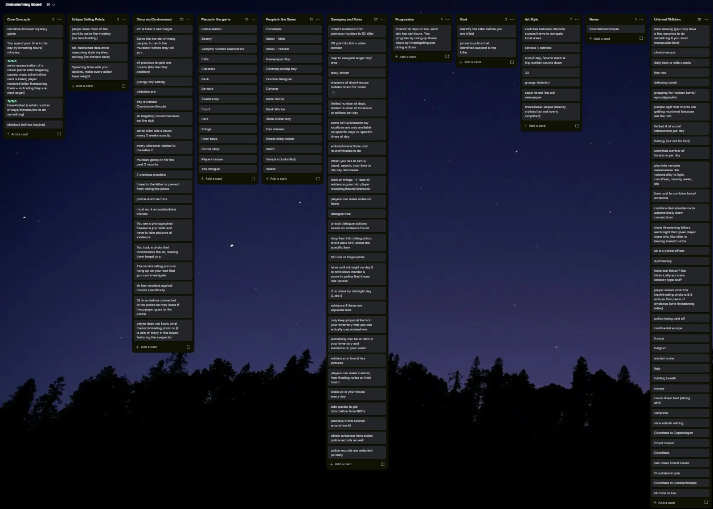
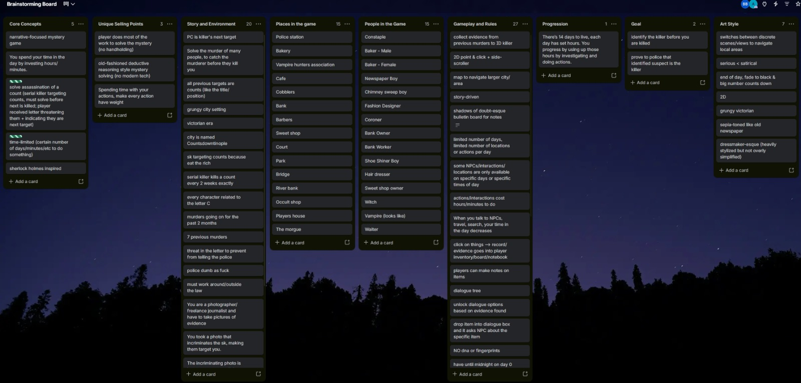
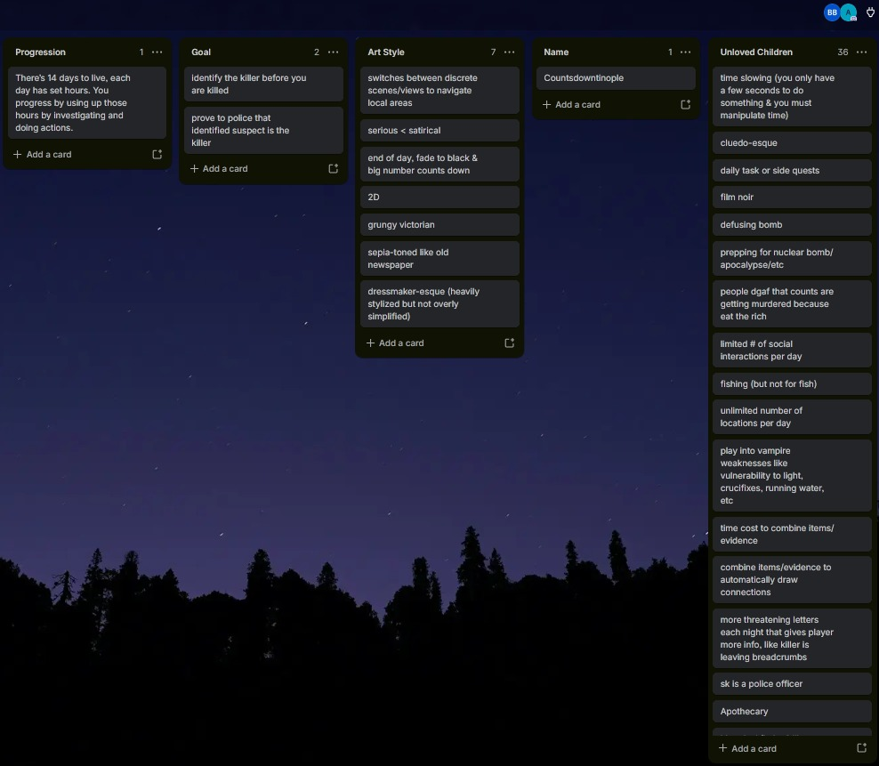

# Brainstorm

We conducted a brainstorming session to come up with and solidify our game.

In the meeting we focussed on these important details:

- Core Concepts
- Unique Selling Points
- Story and Environment
- Places & People in the Game
- Gameplay & Rules
- Progression
- Goals
- Artstyle
- Name

Our session consisted of two parts:

1: Come up with as many ideas as possible in each category

2: Discard any ideas that did not fit with our game concept

By doing this, we could throw as many ideas as possible at the board and come back later to see what worked, and what didn't.

## Trello Board
You can find our brainstorming trello board [here](https://trello.com/b/b57lUYTF/brainstorming-board).

## Details of Brainstorming
We (Aimee Kelly and Beckett Brooks) conducted our brainstorming session on Wednesday, the 30th of September.
This session lasted 2 hours (with a break in between) during our 2 hour break from classes in SETU.

## Images
### Full Board

### Close Ups

