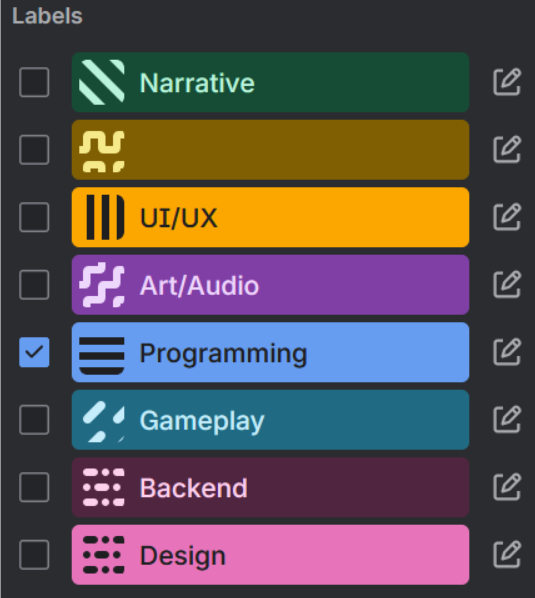
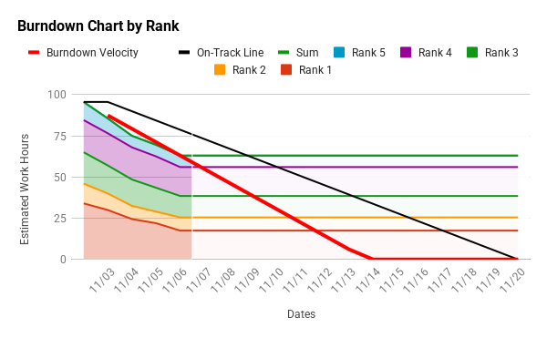

# Scrum - Project Management Plan

## Trello Scrum Board
You can find our scrum trello board [here](http://trello.com/b/IhcR1M7k/igd-ca-scrum-board).

## First Sprint
After creating the product backlog for the game, we extracted the most essential features of the minimum viable product version of the game to focus on in the first sprint. These product backlog items were then broken up into smaller, more specific tasks for the sprint backlog. All sprint backlog tasks were also tagged & color coded by team/responsibility (e.g. design, programming, art & audio, UI/UX design, etc.). Additionally, we created user stories from the product backlog items to help organize the team and enhance our understanding of the sprint goals. 

Here is an image of the labels and their colours in the trello board.
{width=300}

## Burndown Chart
The burndown chart for the sprint tracks the sprint backlog items, ranked by priority, and the progress to completion based on the estimated time requirement. 

Access the burdown chart spreadsheet [here](https://docs.google.com/spreadsheets/d/1_Ai64V6NaU-_yLCmU0s4E9G-z4YM91uuxb9R598kN7o/edit?gid=1060632366#gid=1060632366). The charts can be viewed in seperate pages which you can navigate through at the bottom.

### Burndown 1
{width=800}

### Burndown 2
.png){width=800}

### Burndown 3
.png){width=800}
